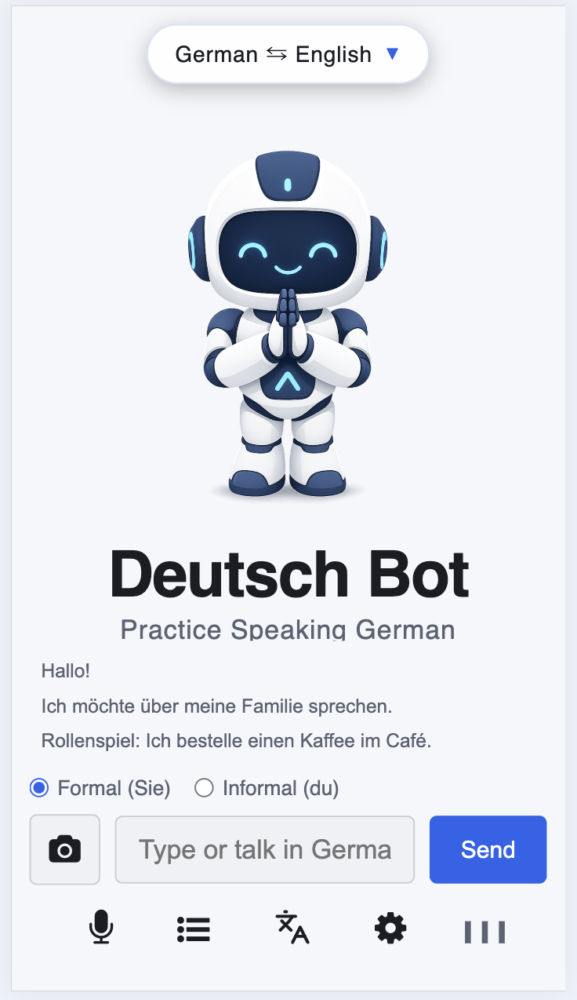
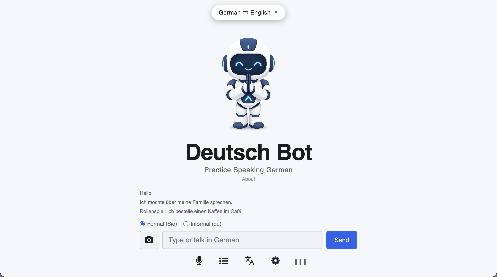

# Deutsch Bot - Practice German Conversation
Deutsch Bot (D-Bot) is a free AI powered chatbot for practicing German conversation. It's designed to help learners in developing countries build the conversational fluency and practical confidence needed to find work or study opportunities in Germany.

Live Demo: 
  
https://d-bot.woza.work/

 

D-Bot is a chatbot for practicing spoken German. There's no fixed course or lesson plan. You just talk naturally and D-Bot responds with both text and voice.

Many learners know English grammar, but find it hard to get real-world conversation practice. Also, many are shy or anxious about making mistakes in front of others.

D-Bot tries to solve these problems by providing a patient, private and low-stress way to practice German conversation on a phone or on a desktop computer.

D-bot is powered by the Qwen3.5-Flash model served via OpenRouter. This is a fast and powerful AI model that currently costs a fraction of a cent per request (https://openrouter.ai/qwen/qwen3.5-flash-02-23). Also, instead of using paid speech-to-text (STT) and text-to-speech (TTS) services, this project uses Javascript SpeechRecognition and Javascript SpeechSynthesis. Both are built into the browser and are free. 

This is a zero friction solution - nothing to download, no registration, no login, no rate limits, no marketing landing page. The user just goes to the website and starts talking.

 
 

Dark mode

 

Correction and translation

 

Supports images

 

Ready-made exercises

 

## Quick Info
- Mobile optimized web app
- Supports both voice and text
- Supports images e.g. upload a photo of a menu and roleplay ordering from it.
- Translates German responses into the user's native language. Supports 86 languages.
- Corrects the user's spelling and grammar errors without disturbing the conversation flow.
- Click any response to replay the audio
- Minimalist UI design with light and dark modes
- Frontend: Html, CSS, Javascript
- Backend: PHP
- Uses the OpenRouter API (qwen3.5-flash-02-23 and qwen/qwen3.7-flash - by Alibaba)
- Set up as a three-agent LLM system - chat, correction, translation
- Uses Javascript SpeechRecognition to convert the user's speech into text
- Uses Javascript SpeechSynthesis to convert text to speech
- Has visual audio cues for deaf learners
- Can be rebranded and self-hosted on any shared hosting platform
- For the best voice quality, the Chrome desktop browser should be used because the latest version now has built in high quality TTS voices. The voice quality on Android mobile devices is also good.

  

## Deployment Notes

- Add your OpenRouter API key to the ebot_config.ini.txt file before uploading to your web host server.
- Change the name of the file from ebot_config.ini.txt to ebot_config.ini
- For added security it's best to locate the ebot_config.ini file outside the web host root folder.

 

## Notes
- This solution needs to be validated. The pain point exists, but does this approach effectively solve it for users who are highly motivated German learners?
- This app needs to be beta tested by learners under real world conditions e.g. using their own mobile devices.
- The voice type and gender may vary across devices and across operating systems.
- The current design is focused on serving motivated, self-directed learners. There's no lesson plan, no gamification, no streaks, and no external prompts to come back. This fact needs to be borne in mind when selecting beta testers - unless there are technical problems, just because someone loses interest in the app doesn't mean it's bad. It could mean that that person is just not who this app was built for.
- The API key can be stolen if the ebot_config.ini file is located inside the website root folder therefore, always locate this file outside the website root folder.
- The latest version of the Chrome desktop browser includes built in high quality TTS voices e.g. Google Deutsch. Therefore, Google Chrome will provide the best desktop user experience. Previously high quality built in voice was only available on Android.
 

## Revision History

Version 1.0 
18-October-2026 
Released for beta testing.

 
